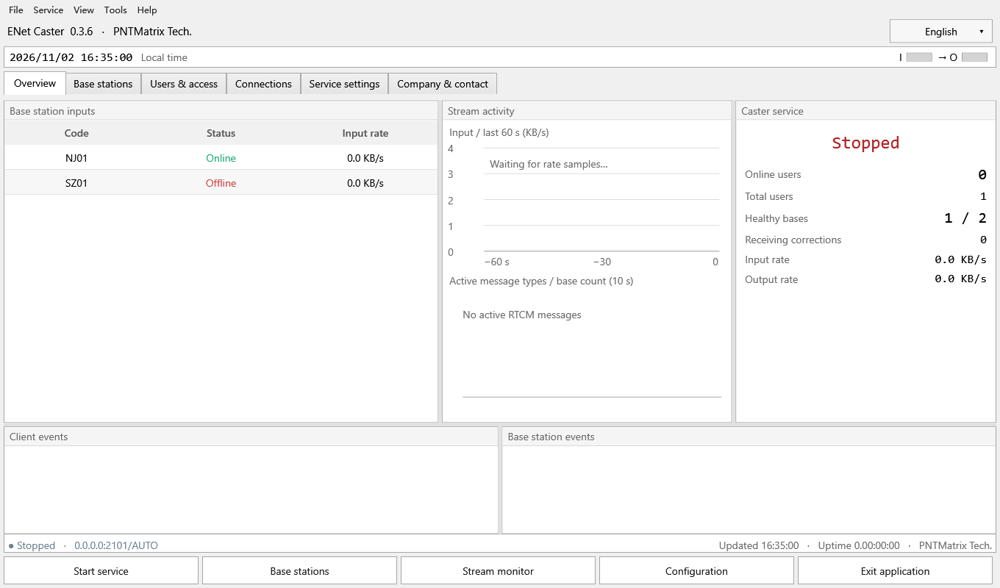

# ENet Caster

ENet Caster is a free Windows NTRIP caster from PNTMatrix for distributing GNSS correction streams from base stations to authenticated rover clients.

ENet Caster 是 PNTMatrix 的 Windows NTRIP Caster，用于将基站 GNSS 差分数据转发给已认证的流动站。

## Downloads / 下载

Choose the ENet Caster v0.3.6 installer for your Windows architecture. / 请按 Windows 架构下载 ENet Caster v0.3.6 安装包。

| Windows architecture / 架构 | Installer / 安装包 |
| --- | --- |
| x64 (64-bit Intel / AMD) | [Download x64 installer / 下载 x64 安装包](https://github.com/aurora970624/ENetCaster/releases/download/ntripcaster/ENetCaster-0.3.6-win-x64-Setup.exe) |
| x86 (32-bit) | [Download x86 installer / 下载 x86 安装包](https://github.com/aurora970624/ENetCaster/releases/download/ntripcaster/ENetCaster-0.3.6-win-x86-Setup.exe) |

[Release notes and assets / 发布说明与附件](https://github.com/aurora970624/ENetCaster/releases/tag/ntripcaster)

## Features / 功能

| Feature | Description |
| --- | --- |
| Base station input / 基站接入 | Up to 50 configured bases. NTRIP push and pull, TCP client and server, and UDP input. / 最多配置 50 个基站，支持 NTRIP 推流与拉流、TCP 客户端与服务端、UDP 接入。 |
| Rover delivery / 流动站分发 | NTRIP credentials and public mountpoints. Routes each rover to the nearest eligible base using its NMEA GGA position. / 通过 NTRIP 账号和公开挂载点接入，依据流动站 NMEA GGA 位置选择最近的合格基站。 |
| Stream operations / 数据流运维 | RTCM monitoring and recording, per-base satellite-system filtering for rover output, user and station maps, and session diagnostics. / 支持 RTCM 监控与录制、按站筛选下发卫星系统、用户和基站地图、会话诊断。 |
| Desktop deployment / 桌面部署 | Chinese and English interface, self-contained Windows builds and local SQLite storage. / 支持中英文界面，程序自带运行时，使用本地 SQLite 存储。 |

## Quick start / 快速开始

1. Install Setup or extract the entire ZIP and run `ENetCaster.exe`. Keep `Assets` beside the portable executable. / 运行安装包，或完整解压 ZIP 后运行 `ENetCaster.exe`，并保留同目录下的 `Assets`。
2. Configure the listener and a public rover mountpoint in **Service settings**. Add a base station and start the service. / 在**服务设置**中设置监听地址、端口和公开挂载点，添加基站后启动服务。
3. Create a rover account. Configure the rover with the caster endpoint, mountpoint and credentials, enable GGA uploads, and confirm RTCM delivery in **Connections**. / 创建流动站账号，在终端配置 Caster 地址、挂载点和账号，开启 GGA 上传，并在**连接**页面确认 RTCM 下发。

## Compatibility / 兼容性

Targets Windows 10 22H2 and Windows 11. The x64 and x86 packages were tested on Windows 11 x64. ARM64 was cross-built and checked for executable architecture. See the release notes for validation limits.

目标平台为 Windows 10 22H2 和 Windows 11。x64 与 x86 包在 Windows 11 x64 上实测，ARM64 已完成交叉构建及可执行文件架构检查。具体验证范围见 Release 说明。

## License and support / 许可与支持

Free binary use and redistribution are subject to the [binary license](LICENSE-BINARY.txt). Third-party notices are included with the downloads. Include your ENet Caster version, Windows architecture, input mode and reproduction steps when reporting an issue. Remove credentials and sensitive site details from any logs you share.

免费使用和再分发按[二进制许可](LICENSE-BINARY.txt)执行，第三方声明随下载包提供。反馈问题时请附软件版本、Windows 架构、接入方式和复现步骤，分享日志前先移除凭据及敏感站点信息。

[PNTMatrix](https://www.pntmatrix.com/) · [Product support](mailto:lysk_gxw@163.com)
